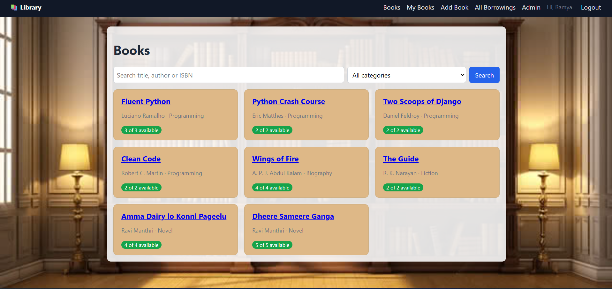
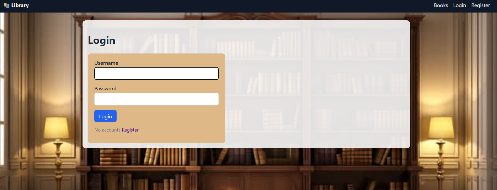
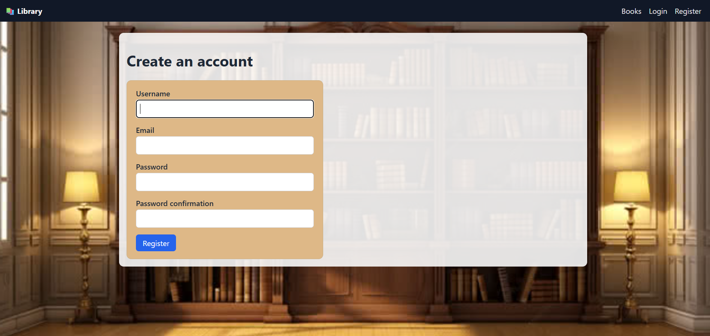
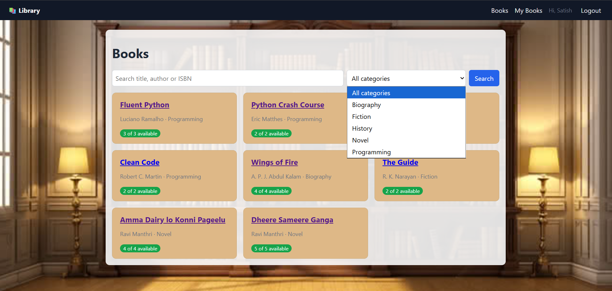
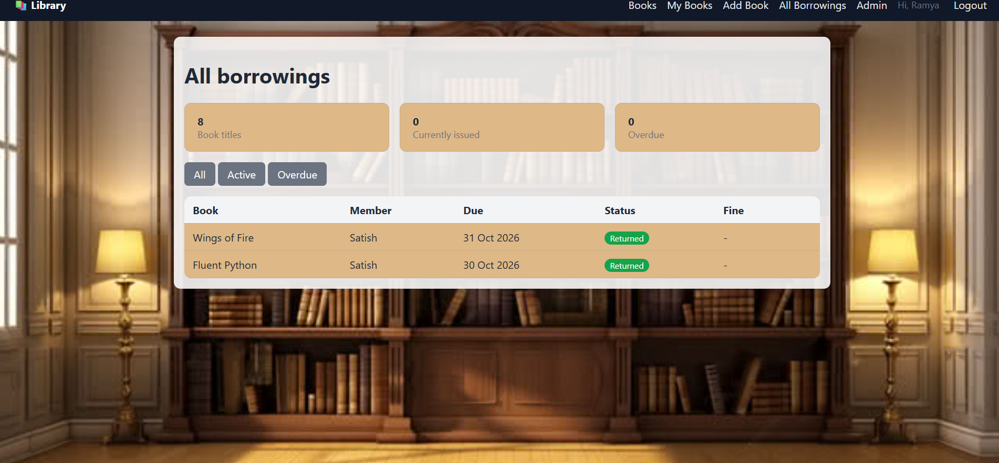
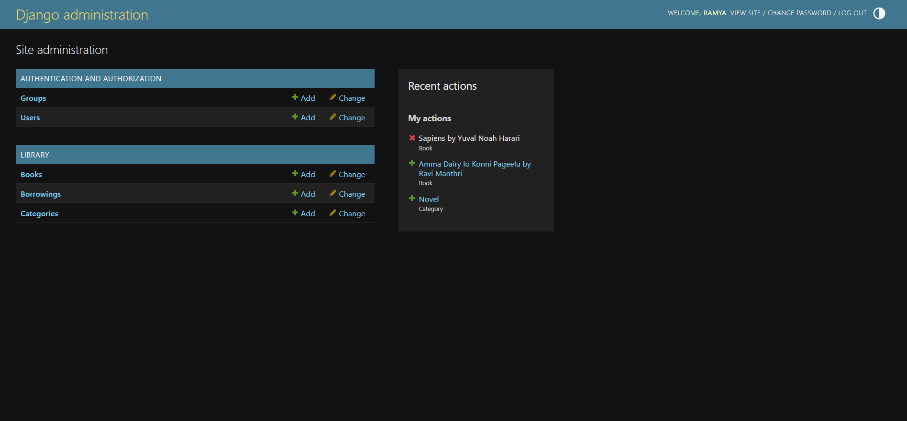

# Django Library Management System

A web app to manage a library's books and borrowers, built with Django.

## Features
- User registration and login
- Add, view, edit and delete books
- Book detail pages
- View all borrowers

## Tech Stack
Python, Django, HTML, CSS, SQLite

## Run Locally
```bash
git clone https://github.com/ramu-ramolu/django-library-management.git
cd django-library-management/library_management
python -m venv .venv
.venv\Scripts\activate
pip install -r requirements.txt
python manage.py migrate
python manage.py runserver
```
Then open http://127.0.0.1:8000/ in your browser.

## Screenshots
### Home Page


### Login


### Register


### User Dashboard


### Borrowings


### Admin Panel


## Author
Ramolu Ramu - [LinkedIn](https://linkedin.com/in/ramu-ramolu-pythonfullstack)
